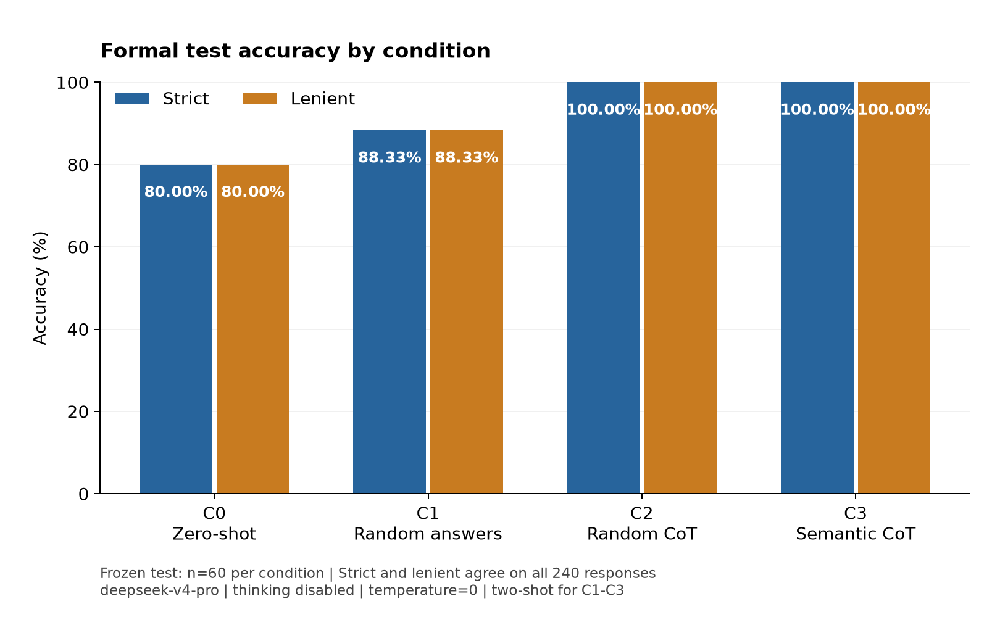
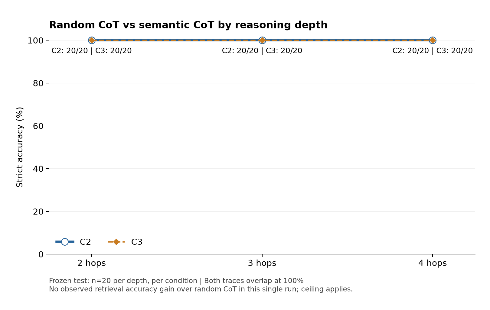

# ICL Reasoning Mini

**Does semantic demonstration retrieval improve few-shot logical reasoning?**

A small, controlled study on a PrOntoQA-derived binary logic task, comparing zero-shot, random answer-only examples, random chain-of-thought examples, and semantic chain-of-thought examples.

**Public research showcase — not an open-source release.** No open-source license is granted for the original project code. Third-party materials retain their own terms. See [rights statement](RIGHTS.md) and [third-party notices](THIRD_PARTY_NOTICES.md).

## Main result

| Condition | Demonstrations and output | Correct / 60 | Accuracy |
|---|---|---:|---:|
| C0 | Zero-shot; final answer only | 48 | 80.00% |
| C1 | Random 2-shot; answer-only examples/output | 53 | 88.33% |
| C2 | Same random examples/order; reference derivations and requested output derivation | 60 | 100.00% |
| C3 | Semantic 2-shot; same derivation format as C2 | 60 | 100.00% |

The primary comparison is **C3 versus C2**: zero observed accuracy gain, with both reaching the ceiling. This does not establish statistical equivalence or prove retrieval universally ineffective. The project proposes no new retrieval algorithm and is not a full reproduction of the referenced papers.



## Beyond accuracy: posthoc C2/C3 derivation minimality

Two exploratory definitions distinguish shortest reasoning from merely shorter text:

- **New-fact minimality:** all core statements are supported, the number of distinct newly derived individual facts (excluding the initial fact and restatements) equals the shortest proof depth, and the displayed content contains a shortest valid proof.
- **Whole-core minimality:** additionally excludes extra standalone rule quotations, repeated facts and off-path branches. Checked query/negation explanations and directionality warnings are not counted as proof steps. Restricted parsing and explicitly reviewed prose normalizations were used; this is not a general natural-language proof verifier.

| Minimality criterion | C2 | C3 |
|---|---:|---:|
| Supported derivation with the minimum number of new facts | 58/60 (96.67%) | 56/60 (93.33%) |
| Stricter whole-core minimality: no extra rule quotations, repeated facts or branches | 58/60 (96.67%) | 55/60 (91.67%) |

Both conditions contained a shortest valid proof in 60/60 outputs, but containing such a proof does not make the entire output minimal or valid. Neither condition achieved whole-core minimality on every question. C3 had two fewer new-fact-minimal outputs and three fewer whole-core-minimal outputs than C2; these are descriptive differences, not significance-tested effects.

The following table lists **all five questions where the number of distinct newly derived individual facts differed**. Short IDs omit the common prefix `prontoqa_v1_seed20261006_`. The fact counts exclude the initial fact and repeated assertions; they are not sentence or token counts.

| Question | Shortest proof depth | C2 new facts | C3 new facts |
|---|---:|---:|---:|
| `h4_example59` | 4 | 5 | 4 |
| `h4_example151` | 4 | 8 | 6 |
| `h3_example61` | 3 | 3 | 7 |
| `h4_example141` | 4 | 4 | 9 |
| `h4_example170` | 4 | 4 | 10 |

**Redundancy differences were bidirectional and question-dependent:** C3 introduced fewer redundant new facts on 2 questions, C2 did so on 3, and the other 55 had equal counts. In `h4_example59`, C3 omitted an unnecessary branch and reached the four-step minimum (5 to 4 new facts); in `h4_example151`, it shortened the derivation (8 to 6) but still exceeded the four-step minimum. Conversely, C2 remained at the minimum on the three questions where C3 derived additional off-path facts. Separately, `h2_example109` had equal new-fact counts but an extra unused rule quotation in C3, explaining the difference between the two minimality criteria.

These observations show local redundancy reduction in either direction, **not an overall C3 improvement or evidence that retrieval causally removes redundant reasoning**. C3 also included one unsupported extra rule statement in `h4_example141`, despite retaining a correct final answer and a valid target proof; all core statements were supported in 60/60 C2 outputs versus 59/60 C3 outputs under the audit's explicit-statement criteria. Total output tokens were higher for C3 (3,841 versus 3,677). The metrics were defined after inspecting outputs, measure visible derivations rather than internal reasoning, and do not establish general efficiency gains. This audit is separate from the 128 public synthetic tests; its underlying raw responses remain excluded from this reduced release.

## Fixed design

- 600 generated candidates; 120 demo, 20 dev, 60 test, 400 unused. Splits are separated by question ID and logical world.
- Formal test: balanced True/False labels, 20 questions at each depth 2/3/4; four conditions give 240 responses. Development results are not pooled into this score.
- False means the explicit negation is derivable, not merely that the query is unproven.
- Every few-shot prompt uses one True-label and one False-label demo, True first. C1/C2 share random demonstrations and order, seed `20261009`.
- Semantic retrieval: fixed MiniLM-L6-v2, normalized 384-dimensional vectors, label-balanced cosine top1 selection, excluding the target ID/world.
- Target answers, depths and proofs are not used in target encoding, selection or generation. Selected demo labels and reference derivations have their specified roles.
- Answering API alias: `deepseek-v4-pro`; thinking disabled, temperature 0, max output tokens 1024. The alias does not independently identify immutable serving weights. No training or fine-tuning.
- Formal saved responses all ended normally on their first attempt; incorrect content was not retried.

## What is published

```text
scripts/          Experiment implementation and selected core tests
configs/          Inference and retrieval configurations
results/          Aggregate experimental statistics
figures/          Two result figures in PNG and SVG
environments/     Candidate environment configuration
tools/            Validation tools for this public package
docs/             Supporting documentation and release records
```

This repository provides selected code, configurations, aggregate results and figures for research demonstration. It does not include all datasets, original model responses and intermediate artifacts required to reproduce the experiments. **The published materials alone are therefore insufficient for complete end-to-end reproduction.**

## Safe checks for this public package

Use Python 3.12 on a Unix-like system. The selected core tests need only the standard library; this has been verified on macOS ARM64, not all platforms.

```bash
python -B tools/run_public_checks.py
```

This checks the public file manifest and aggregate tables, then runs an explicitly selected set of synthetic tests for parsing, client guards, logs, retry/resume, budget simulation, simulated execution and logical validation. Outbound socket connections are blocked. Tests use temporary files and fake responses; no real API or model is invoked.

The count for this subset is reported in [release validation](docs/RELEASE_VALIDATION.json). It must not be conflated with the 318 historical private-workspace tests or the 14 later portability tests.

The [environment candidate](environments/environment.analysis.osx-arm64.candidate.yml) captures the broader analysis setup. A fresh environment on the same macOS ARM64 host passed installation/runtime checks and the original 318 tests in an isolated full workspace copy. This does **not** make the reduced package an end-to-end or cross-machine reproduction, nor is the YAML an artifact-hash lock.

## Interpretation and limitations

- C1 fixed 8 C0 errors but introduced 3; the net improvement was 5 questions. C2 fixed all 7 C1 errors.
- C2 versus C1 changes both demonstration reference chains and the request to produce a derivation; it is not a single-factor causal estimate of CoT.
- C3 used 44,767 input tokens versus C2's 43,084 (+3.91%); token counts are not a bill or an end-to-end efficiency measurement.
- One answering model, synthetic task subset, fixed 2-shot, one seed and one generation run; no confidence intervals or significance tests are reported.
- Data review used one human blind answer plus eleven assistant-assisted nonblind checks, not twelve independent human blind reviews.
- The original Day6 case analysis was posthoc, nonblind and purposively selected, inspecting twenty displayed derivations. The later full-set C2/C3 audit above remains exploratory and limited to visible output under restricted parsing; neither analysis establishes the model's internal reasoning mechanism.
- No extra test tuning or best-of-rerun selection was performed after observing formal results.



## References

1. Long, Q., Wu, Y., Wang, W., & Pan, S. J. (2024). *Does In-Context Learning Really Learn? Rethinking How Large Language Models Respond and Solve Tasks via In-Context Learning*. COLM. <https://arxiv.org/abs/2404.07546>
2. Saparov, A., & He, H. (2023). *Language Models Are Greedy Reasoners: A Systematic Formal Analysis of Chain-of-Thought*. ICLR. <https://arxiv.org/abs/2210.01240>


